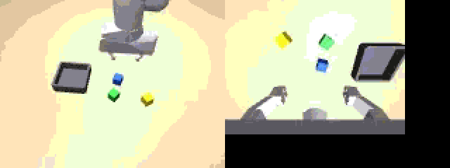
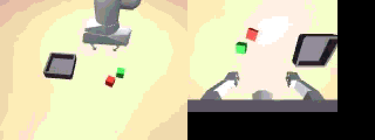

# robot-learning-stack

From ROS 2 recordings to a deployed robot policy: multimodal capture with sensor-health checks,
synchronisation and curation, LeRobot v3 datasets that mix ROS 2 recordings with synthetic data,
policy training and closed-loop benchmarks, and an ONNX policy runtime and skill executor back in
the ROS 2 graph.

The robot is a simulated Franka Panda (MuJoCo, [Menagerie](https://github.com/google-deepmind/mujoco_menagerie)
model) with a front RGB-D camera, a wrist camera, joint encoders and a wrist force-torque sensor,
doing language-conditioned pick-and-place and stacking ("stack the blue cube on the yellow cube").
It is driven through a real ROS 2 Jazzy graph. Each camera runs on its own drifting clock, and the
simulator injects dropped frames, burst drops, outages, corrupt frames and camera calibration
errors while recording exactly what it injected, so every data check in this repository is scored
against ground truth.

> **All numbers below were measured in this repository on a 2-core CPU machine, in simulation.**
> Nothing here has run on a physical robot. See [Limits](#limits).

## Results at a glance

<p align="center"> <br>
<sub>Benchmark episodes on held-out seeds: "stack the yellow cube on the blue cube", "put the green cube in the bin". Left: front camera, right: wrist camera, as the policy sees them.</sub></p>

**Data capture and health** (21 ROS 2 sessions, 252 teleop episodes, every check scored against injected truth)

| check | result |
|---|---|
| per-episode camera drop rate | exact at the median, worst episode off by 1.0 point |
| corrupt frames (black, saturated, frozen, undecodable) | 239 of 241 caught |
| camera clock offset (wrist camera +120 ms and 600 ppm drift) | recovered within 7 ms median, 11 ms worst (frame period 67 ms) |
| published camera extrinsics off by 4 cm and 3° (stress sessions) | 6 of 7 flagged, 6 false alarms in 245 clean episodes |
| live C++ monitor during recording, drop rate per stream | within 1.7 points of truth on every stream in every session |
| truncated bag (recording killed at 60%) | every complete episode recovered, the cut one marked failed |
| curation | 557 episodes in, 455 kept; all 10 eligible re-recorded duplicates and all 5 re-imported copies found, 0 false positives |
| release | LeRobot v3.0 with LeRobot's writer: 455 episodes, 53,547 frames, 94 MB; our reader matches `LeRobotDataset` pixel for pixel |
| video encoding (GOP 2, as released) | AV1 829 B/frame at 38.8 dB PSNR vs H.264 837 B at 37.8 dB; 69x smaller than raw ([study](reports/codec/CODEC_STUDY.md)) |

**Policy** (`act_main`: language-conditioned action chunking with FiLM, 409 training episodes, 6000 steps, 2.4 h on one CPU core;
closed-loop on held-out seeds, 30 episodes per split, 95% Wilson intervals)

| split | success | | split | success |
|---|---|---|---|---|
| in distribution | 43% (27-61) | | lighting shift | 37% (22-54) |
| unseen object positions | 50% (33-67) | | camera pose shift | 53% (36-70) |
| two extra distractors | 70% (52-83) | | unseen colours (purple, orange) | 17% (7-34) |

Pick-and-place succeeds 53-93% across seen-colour splits, stacking 13-47%. The first recipe reached 3/40;
[docs/training.md](docs/training.md) and study 4 in [STUDIES.md](reports/studies/STUDIES.md) show what changed
(tool-pose actions, proprioception noise and dropout against the copycat shortcut, an auxiliary object-localisation
loss, FiLM conditioning) and the probe that explains it: before the arm moves, the final policy locates the instructed
cube within 30 mm in 75% of validation episodes, against 2-10% without FiLM.

**Deployment over ROS 2** (same policy as ONNX in the runtime node, realistic sensor faults, 20 episodes)

| | result |
|---|---|
| success over ROS 2 | 50% (30-70), in line with 43% in process |
| with the calibrated camera offset only | 20%: the wrist clock drifted out of the sync window and the node held position on 56% of ticks; online drift tracking fixed it (3 skewed ticks of 4204) |
| multi-step instructions through the skill executor (10 episodes) | first step 10/10 (with retries), both steps 3/10; RGB-D postcondition checks agree with simulator truth 95% of the time |
| ONNX vs PyTorch | max difference 8e-6; ONNX inference p95 34 ms on an idle core (control period 67 ms) |
| release gate (`scripts/release_check.py`) | [PASS](reports/release/act_main/RELEASE_CHECK.md): data health against truth on a fresh ROS 2 recording, ONNX parity and latency, closed-loop success against the stored baseline. It failed twice on the way: once on the recorder bug below, once on latency (p95 69 ms) while two training jobs shared the machine |

**Studies** ([STUDIES.md](reports/studies/STUDIES.md); 20 episodes per cell, same recipe, 1500 steps)

| question | finding |
|---|---|
| teleop vs synthetic vs both | both 35% in distribution, synthetic only 20%, teleop only 15% (intervals overlap) |
| policy class | action chunking 35%, single-step BC 0%, diffusion head 0% at this step budget |
| `act_main` with observations 133 / 267 ms old, or actions applied 2 ticks late (30 episodes each) | 47%, 50%, 50% vs 43% as trained: no measurable loss; the moves are slow and chunked actions with temporal ensembling absorb the delay |
| fine-tuning `act_main` to two unseen cube colours from 10 or 25 demos (LoRA, full, scratch; 600-1500 steps) | a negative result: nothing beat the base policy's 17% on unseen colours (5-20%, intervals overlap); LoRA at a high learning rate cost in-distribution success (43% to 15%), full fine-tuning at 1e-4 kept it (30-50%) |

**Reinforcement learning** (PPO reach-and-hold on the Panda, 200 evaluation episodes each)

| policy | nominal robot | randomised dynamics | held-out "target" dynamics |
|---|---|---|---|
| trained on nominal dynamics (400k steps) | 200/200 | 76/200 | 0/200 |
| trained with domain randomisation (1M steps) | 200/200 | 200/200 | 200/200 |

The target dynamics (weaker actuators, a heavier tool, two ticks of actuation latency) lie partly outside the
randomisation ranges. The first randomised run reached 3% after 400k steps; adding the in-flight commands to the
observation (with 2 ticks of latency the state is not Markov without them) and training longer fixed it, two changes
at once, so neither alone is credited.

**Bugs the checks found in this repository's own pipeline**, each fixed with a regression check:
a stamp-rounding bug that put one 120 Hz message per second one second in the past (found by the C++ monitor);
recordings that never finalised their bags because a background launcher's children ignored SIGINT;
the recorder missing the first seconds of a session once the monitor also subscribed (found by the release gate);
the executor planning against the previous episode's last camera frame.


## What is in here

| stage | code | what it does |
|---|---|---|
| capture | `rls/ros/driver.py`, `teleop.py`, `session.py` | ROS 2 nodes for the simulated robot and its sensors (120 Hz joints and F/T, 15 Hz RGB-D and wrist camera, `camera_info`, `/tf_static`), a scripted teleoperator, rosbag2 recording (MCAP, sim time, lockstep) |
| live health | `cpp/rls_sync_monitor` (C++, rclcpp) | per-stream drop rate, gaps, message age and camera stamp skew on `/diagnostics` while recording |
| ingest | `rls/data/bag.py`, `sync.py`, `calib.py`, `ingest.py` | reads MCAP without ROS (tolerates truncated bags), estimates camera clock offset and drift, checks extrinsics, aligns every stream causally onto 15 Hz control ticks, flags repaired frames, writes one HDF5 per episode |
| synthetic | `rls/data/synthetic.py` | domain-randomised episodes from the same simulator in the same schema |
| curation | `rls/data/curate.py` | health / outcome / length filters, exact and near-duplicate detection, deterministic stratified splits, content-hashed dataset version |
| release | `rls/data/export_lerobot.py` | LeRobot v3.0 via LeRobot's own writer (AV1 video), lineage back to the source bag |
| training | `rls/learn/` | model-agnostic trainer (policy registry), ACT-style chunking transformer, single-step BC, diffusion head, LoRA / head / full fine-tuning, MLflow tracking, resumable checkpoints, ONNX export with parity check |
| evaluation | `rls/learn/benchmark.py`, `scripts/run_studies.py` | closed-loop benchmark on 6 generalisation splits, Wilson intervals, failure taxonomy, videos, studies |
| deployment | `rls/ros/policy_node.py`, `executor_node.py`, `evaluate.py` | ONNX policy runtime in the ROS 2 graph (freshness and cross-camera sync checks, latency diagnostics); skill executor with a rule or LLM planner and RGB-D postcondition checks |
| RL | `rls/rl/` | PPO (Stable-Baselines3) with domain randomisation, evaluated on held-out dynamics, ONNX actor |
| tooling | `rls/cli.py`, `rls/tools/viewer.py`, `scripts/release_check.py` | one CLI for every stage, a web viewer for episodes, runs and benchmarks, a release gate used by the nightly workflow |

Docs: [architecture](docs/architecture.md) · [dataset schema](docs/dataset.md) · [training notes](docs/training.md) · [runbook](docs/runbook.md)

## Quick start

```bash
pip install -e ".[dev]"                                  # Python 3.12; CPU torch is enough
source /opt/ros/jazzy/setup.bash                         # only for recording and ROS deployment
cmake -S cpp/rls_sync_monitor -B build/mon && cmake --build build/mon && \
  cmake --install build/mon --prefix cpp/rls_sync_monitor/install   # optional C++ monitor

python scripts/build_dataset.py --root data              # record over ROS 2 -> ingest -> synth -> curate -> release
rls train configs/train/act_main.yaml
rls export runs/act_main/best --out runs/act_main/policy.onnx
rls bench runs/act_main/best --onnx runs/act_main/policy.onnx --splits in_distribution,position_ood --episodes 30 --out reports/bench/act_main
rls deploy runs/act_main/best --onnx runs/act_main/policy.onnx --episodes 10 --out reports/deploy
rls viewer                                               # http://127.0.0.1:8765
```

Releases need LeRobot in its own environment (`RLS_LEROBOT_PYTHON`, see the [runbook](docs/runbook.md)).
A `Dockerfile` on `ros:jazzy-ros-base` packages all of it.

## Limits

* **Simulation only.** No physical robot, no real cameras, no real teleoperation device. The fault
  model is built from how real capture rigs fail, but it is a model; the success rates are
  simulation success rates and say nothing about a real cell.
* **Scripted operator.** "Teleop" demonstrations come from a scripted operator with per-episode style
  noise and occasional sloppy grasps, not from a human.
* **Small compute.** Policies train for a few thousand steps on 2 CPU cores; published ACT and
  diffusion-policy results use one to two orders of magnitude more. Benchmarks use 20-40 episodes per
  cell, so confidence intervals are wide and stated everywhere.
* **No pretrained VLA.** The training framework is model-agnostic and fine-tunes with LoRA, but the
  models here are trained from scratch; no OpenVLA / π0 / SmolVLA checkpoint was fine-tuned.
* CI (lint, type check, unit tests and the ROS 2 end-to-end job) runs on GitHub Actions and passes. The
  nightly workflow has not fired yet and the Dockerfile has not been built here; their steps were run
  locally.

## License

Apache-2.0. The Franka Panda model under `rls/sim/assets/franka_panda` is from MuJoCo Menagerie
(Apache-2.0, see its LICENSE).
